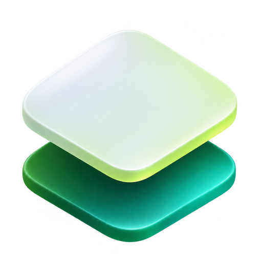

<h1 align="center">OpenShot</h1>

A free screenshot and video mockup editor for the web and desktop.

<a href="https://github.com/overlytiwa/open-shots/releases/latest">Download desktop</a> · <a href="docs/editor.md">Using the editor</a> · <a href="docs/features.md">Features and limits</a>

OpenShot puts your screenshot or screen recording into a frame you can use in a post, presentation, product page or documentation. Pick a device, adjust the layout, add a background and export. It opens with an empty canvas, ready for your own image. No sample screenshot is bundled, including inside the device-model files.

There is no account, subscription, export allowance or forced OpenShot watermark. Your files are edited and rendered on your device. The web and desktop versions use the same editor.

## Editing

The Mockup panel contains the frame, media, corner and shadow controls. The Frame panel contains the background, scene overlays, effects and watermark. Position, zoom, tilt and layout previews sit on the right. Changes between layouts animate smoothly, and the interface respects reduced-motion settings. The white, mint, green and teal palette comes from OpenShot's icon.

Device mockups use independently licensed 3D models rather than the generic device drawings from the first release. The catalog includes iPhone 17 Pro Max, iPhone 12 Pro, Galaxy S21 Ultra, iPad mini 6, MacBook Pro 16-inch, a desktop monitor and Apple Watch Series 7. A rendered frame fallback works when WebGL is unavailable. [Model credits](docs/device-models.md) identify the artists and licenses. Exports using CC BY models include attribution; keep it with published work.

Screenshot frames include Default, Glass Light, Glass Dark, Liquid Glass, Inset Light, Inset Dark, Outline, Border, Retro, Card, Stack and Stack 2. Browser and application window frames are available too. You can combine media, text, code cards and shapes, or start with a template.

## Animation and export

Add a timed animation, select its clip, then choose its target layout and transition duration. Drag the clip to change its time or drag an edge to change its duration. The timeline also supports playback, scrubbing and looping. Motion presets and explicit keyframes remain available in Animation settings.

Export PNG, JPG, WebP, MP4, WebM or GIF, or copy a PNG to the clipboard. Video is encoded frame by frame so a slower machine does not silently drop timeline frames. Unmuted video clips retain their audio. A local AAC encoder covers browsers without native AAC encoding. PNG, WebP and WebM support transparency; MP4 uses black behind transparent content. GIF has binary transparency and a 15 fps limit.

The editor includes a palette of green and teal gradients, custom colors, uploaded backgrounds, media-derived colors, blurred media, grain and scene overlays. Effects include VHS, TV, glitch, light leak, particles and glitter. These are independent implementations, not the reference site's private effect algorithms.

## Desktop

[GitHub Releases](https://github.com/overlytiwa/open-shots/releases/latest) contains the Windows x64 installer, Linux x64 AppImage and Debian package, and macOS DMG/ZIP files for Intel and Apple silicon. The website's desktop download button links to these files.

The desktop app bundles the editor, fonts, models and encoders for offline use, and adds native screen/window capture. Builds are unsigned until the maintainer configures signing credentials. GitHub Actions builds each platform on its matching operating system.

## Projects and privacy

OpenShot autosaves one current project in local IndexedDB storage. Clearing browser data can remove that copy. Save an `.openshot` project file to keep a portable copy, including its media. There is no cloud media store or account sync.

Share links contain a compressed copy of the project, including its media, in the URL fragment. The fragment is not sent in the initial web request. Anyone who receives the complete link can open the contents. There is no hosted link database or access-control system. Use a project file for large images and videos.

There is no analytics or advertising code. Optional Unsplash search talks to Unsplash, and desktop downloads talk to GitHub.

## Scope

OpenShot is an independent alternative to Shots. The editor was revised after hands-on tests with desktop and phone images. [The reference review](docs/reference-audit.md) records the observed behavior and the remaining differences. It does not claim an exhaustive match with every paid control. Automatic portrait subject masking, the full device catalog, proprietary wallpapers and paid scene assets are not included.

OpenShot's source is MIT licensed. Models and third-party libraries retain their own licenses, listed in [third-party notices](docs/third-party.md). OpenShot is not affiliated with Shots or the separate OpenShot Video Editor project.

## Website and releases

The repository is ready to import into Vercel as a Vite project. Its build command and output directory are declared in `vercel.json`. Editing and exports need no database or environment variables. Optional photo search uses a server-only `UNSPLASH_ACCESS_KEY`.

Pushes and pull requests run the tests and website build. A new package version pushed to `main`, or a version tag, builds all four desktop targets and publishes their installers after every job succeeds. An ordinary push keeps existing releases unchanged. A manual workflow run produces artifacts without publishing. [Release documentation](docs/releases.md) covers the process.
