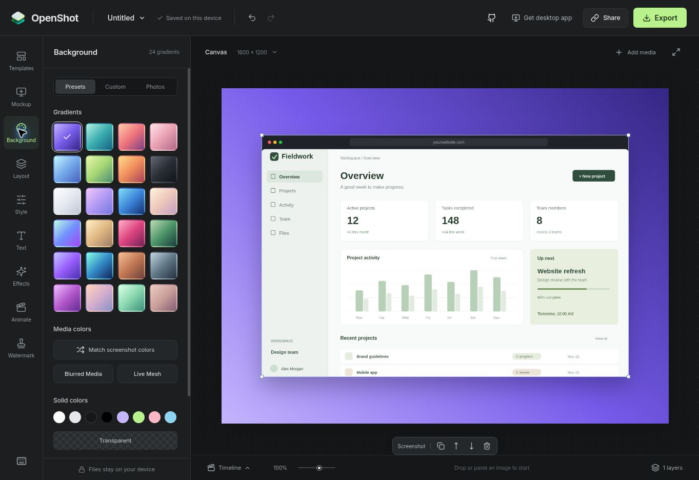

<h1 align="center">OpenShot</h1>

A free screenshot and video mockup editor for the web and desktop.

<a href="https://github.com/overlytiwa/open-shots/releases/latest">Download desktop</a> · <a href="docs/editor.md">Using the editor</a> · <a href="docs/features.md">Features and limits</a>

OpenShot takes an image or screen recording and puts it in a layout you can use in a post, a presentation, a product page, or documentation. Add a background, pick a frame, adjust the crop and lighting, and export. Use the same editor in a browser or in the desktop application.

There is no account, subscription, export allowance, paid template tier, or OpenShot watermark. Editing and rendering happen on your device. Your screenshots do not need to pass through someone else's server to get a background and rounded corners.

## What it does

| Area           | Included                                                                                                                                                                          |
| -------------- | --------------------------------------------------------------------------------------------------------------------------------------------------------------------------------- |
| Media          | Import, drop, or paste images and videos. Replace individual screens in a layout.                                                                                                 |
| Frames         | Screenshot, Chrome, Safari, Arc, macOS, Windows, iPhone, Android, iPad, MacBook, desktop display, watch, and Polaroid.                                                            |
| Device options | Phone, tablet, laptop, desktop, and watch variants, frame colors, portrait and landscape orientation. These are original procedural illustrations.                                |
| Layout         | Twelve templates, single, paired, stacked, and grid arrangements, independent layers, drag, resize, ordering, visibility, and locking.                                            |
| Background     | Twenty-four gradients, custom colors and gradients, transparency, uploaded images, media-matched colors, blurred media, moving mesh, patterns, grain, and shadow overlays.        |
| Style          | Glass, inset, outline and border treatments, corner radius, padding, shadows, light direction, and reflections.                                                                   |
| Effects        | Three-axis rotation, perspective, scale, crop, horizontal and vertical flip, monochrome, warm, cool, vintage, VHS, glitch, brightness, contrast, saturation, and blur.            |
| Overlays       | Text, code cards, circles, rectangles, rings, arches, spheres, and cubes.                                                                                                         |
| Motion         | Twenty-four motion presets plus a still setting, per-layer keyframes, easing, timeline scrubbing, looping, focus zoom, pan, orbit, parallax, entrances, and video trimming/speed. |
| Branding       | Your text or logo, with position, size, and opacity controls.                                                                                                                     |
| Export         | PNG, JPG, WebP, MP4, WebM, GIF, and PNG to clipboard. Custom dimensions and social presets.                                                                                       |
| Projects       | Automatic local saving, portable `.openshot` files with embedded media, undo/redo, and self-contained share links.                                                                |
| Desktop        | The same editor, bundled for offline use, with native screen/window capture.                                                                                                      |

## Why it is free

A screenshot editor should be useful without a recurring bill. OpenShot keeps its editing tools and exports available to everyone, and publishes its source under the MIT license. You can inspect what it does, change it, and keep using the version you have.

The project does not run a cloud rendering service or store your media. That keeps the ordinary editing workflow independent of a subscription backend. Optional Unsplash search talks to Unsplash, and downloading a desktop release talks to GitHub. The editor has no analytics or advertising code.

## Desktop downloads

Get the current installers from [GitHub Releases](https://github.com/overlytiwa/open-shots/releases/latest). The website's **Get desktop app** button points to the same release files.

| System              | Package                     |
| ------------------- | --------------------------- |
| Windows x64         | Installer                   |
| macOS Apple silicon | DMG and ZIP                 |
| macOS Intel         | DMG and ZIP                 |
| Linux x64           | AppImage and Debian package |

Builds are unsigned until signing credentials are configured. Windows or macOS may display a security prompt. Native packages are built on their matching operating systems by GitHub Actions.

## Your files

OpenShot autosaves the current project in the browser's IndexedDB storage. In the desktop app, that storage belongs to the app. It is not synchronized between devices. Clearing browser data can remove the local copy, so use **Save project** to keep important work as a file.

Share links contain a compressed copy of the project, including its media, in the URL fragment. The fragment is not sent in the initial web request. Anyone who receives the complete link can open the contents. There is no hosted link database or access-control system. Use a project file for large images and videos.

## Feature scope

OpenShot is an independent alternative to Shots. It implements the publicly visible screenshot and video mockup workflows with its own renderer, interface, artwork, and templates. It does not reuse Shots' device models, wallpapers, source code, or branding. Its illustrated frames are not scans or licensed photorealistic models of every device Shots offers.

An exhaustive match with every paid or account-only control in Shots has not been verified. [Features and limits](docs/features.md) records what is implemented and where the behavior differs. In particular, animations currently export without audio, MP4 support depends on the available H.264 encoder, and Unsplash search requires an optional server key.

## Website hosting and releases

The repository includes a Vercel configuration. Import this repository into Vercel as a Vite project; the build command and output directory are already declared. No database or environment variables are needed for editing and exports. For optional background photo search, set `UNSPLASH_ACCESS_KEY` in Vercel. Never put that key in a `VITE_` variable.

Every push and pull request runs the tests and builds the website. Pushes to `main` and version tags such as `v1.0.0` trigger Windows, Linux, Intel Mac, and Apple silicon Mac packages. After all four jobs succeed, GitHub publishes a release when the package version has not been released before. Existing releases stay unchanged on ordinary branch pushes. A manual Desktop workflow run builds downloadable workflow artifacts without publishing a release. [Release notes](docs/releases.md) covers this process without requiring end users to build anything.

OpenShot is not affiliated with Shots or the separate OpenShot Video Editor project. Device and browser names identify the type of frame being illustrated. Their trademarks belong to their respective owners.
